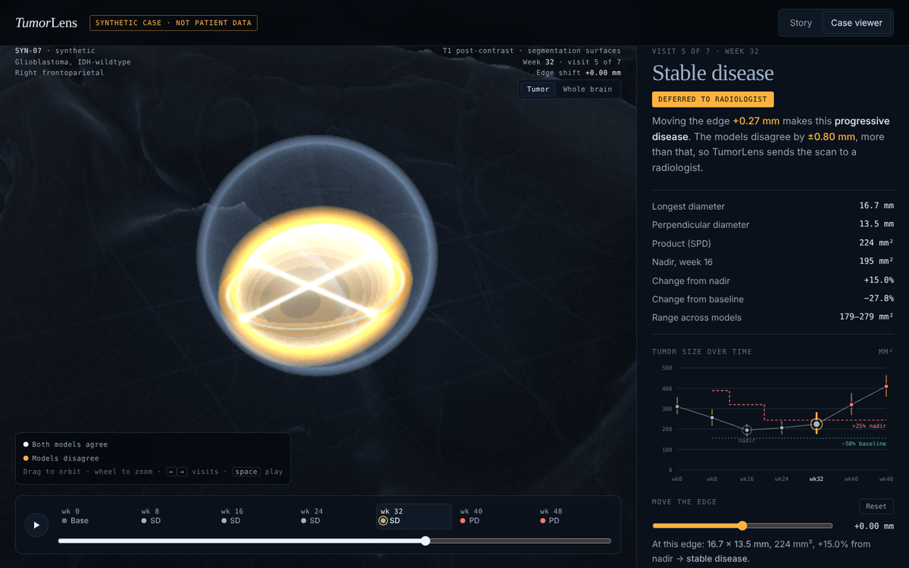

# TumorLens

**After glioblastoma surgery, the scans are measured and a response call is made. How much of that call depends on where the tumour boundary is drawn, and can a system tell when its own answer should not be trusted?**

<p align="center"><a href="https://drvnv2000-lab.github.io/tumorlens/"></a></p>

<p align="center"><a href="https://drvnv2000-lab.github.io/tumorlens/"><b>Open the interactive demo</b></a> (laptop browser, WebGL2)</p>


## Where this stands

| Part | Status |
|---|---|
| Interactive demo: cinematic story, 3D case viewer, "move the edge" slider that flips the verdict | Built, on a **synthetic** case (no patient data) |
| RANO bidimensional measurement and response calls (nadir rule, flip margin), written from the published criteria | Built, tested on geometric phantoms |
| Analysis plan for real data (LUMIERE) | Committed before any analysis: [`PREREGISTRATION.md`](PREREGISTRATION.md) |
| Real LUMIERE cases in the demo, results | In progress |

<p align="center"></p>

## What is real and what is simulated

Everything in the demo today is simulated: one synthetic patient, illustrative numbers, labelled as such on the page.
The measurement code is real and tested. The data plan uses LUMIERE (91 glioblastoma patients, CC0): expert RANO ratings,
expert bidimensional measurements, and two automated segmentations. [`PHASE0.md`](PHASE0.md) records what that sheet can and cannot support:
149 follow-up visits have expert measurements, mostly progression calls, so the study is descriptive and says so.

## How we avoid fooling ourselves

- The analysis plan is committed before any automated measurement is compared with an expert one.
- No model is trained: the two segmentations ship with the dataset.
- Calls compare with the **nadir**, not the previous scan or the baseline, as RANO requires.
- Intervals come from a patient-level bootstrap, because visits from one patient are not independent.
- Limits are written down before the results.

## Relation to prior work

Suter et al. (2022, 2023) released LUMIERE and compared automated longitudinal measurements with expert ratings; TumorLens builds on that and does not repeat it.
OncoSeg (Yu, 2026) maps expert RANO labels to RECIST-style categories; TumorLens implements bidimensional RANO directly.
No OncoSeg code was used; this repository was written from scratch from the primary sources.

## Run it

```bash
python -m venv .venv && . .venv/bin/activate
pip install -e ".[dev]"
pytest -q
```

Open `docs/index.html` in a browser to run the demo locally.

## Licence

MIT. Data: LUMIERE (CC0). Not a medical device; nothing here is clinical advice.
