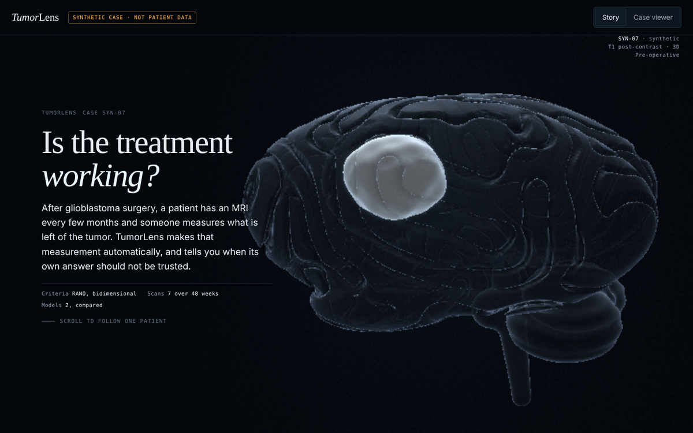

# TumorLens

**After glioblastoma surgery, follow-up MRIs are measured and a response call is made. How much does an automated, measurement-driven call depend on measurement conventions and on where the tumour edge is drawn?**

On 350 real follow-up calls per tool from the LUMIERE dataset, a uniform 1 mm offset of every tumour edge in a patient's series changed **17%** of HD-GLIO-AUTO's calls and **28%** of DeepBraTumIA's, under the study's call rules. This is a descriptive methods study, not a validation of automated clinical response assessment.

<p align="center"><a href="https://drvnv2000-lab.github.io/tumorlens/"></a></p>

<p align="center"><a href="https://drvnv2000-lab.github.io/tumorlens/cases.html"><b>15 real cases</b></a> · <a href="https://drvnv2000-lab.github.io/tumorlens/"><b>Story and synthetic 3D walk-through</b></a> (laptop browser, WebGL2) · <a href="docs/V1_RESULTS.md"><b>Results</b></a> · <a href="https://drvnv2000-lab.github.io/tumorlens/tour.mp4"><b>60 s tour</b></a></p>


## What v1 found (LUMIERE, descriptive)

Both segmentations released with LUMIERE were measured on all 638 visit folders (599 readable per tool) the RANO way: largest enhancing lesion, its largest slice, longest diameter and longest perpendicular. Calls compare with the nadir and ignore confirmation, steroids, clinical status and non-enhancing disease. Intervals are 95% patient-level bootstrap intervals (10,000 resamples). An independent review (ChatGPT) was run on v1; its requests are implemented and recorded in [`PREREGISTRATION.md`](PREREGISTRATION.md).

| | HD-GLIO-AUTO | DeepBraTumIA |
|---|---|---|
| Calls changed by a uniform 1 mm offset (350 calls, 73 patients) | 17.1% (12.4 to 22.7) | 28.3% (22.2 to 33.9) |
| Calls changed within 2 mm | 37.7% (31.4 to 44.4) | 54.6% (46.9 to 61.7) |
| Automated / expert size, median (102 visits); pixel-centre, post hoc | 1.35 (1.22 to 1.44); 1.20 (1.07 to 1.34) | 1.38 (1.31 to 1.49); 1.24 (1.16 to 1.34) |
| Same direction as the expert, consecutive visits, volume (43 pairs, 17 patients) | 83.7% (72.2 to 97.0) | 79.1% (67.3 to 94.1) |
| Exploratory: AUROC of fragility for disagreement with the expert call (350 calls) | 0.60 (0.54 to 0.67) | 0.65 (0.58 to 0.71) |

- **Numerically similar to Suter et al. 2023, not a replication.** They reported 81.1% trend agreement for HD-GLIO volume; v1 gets 83.7% on the 43 pairs the released sheet supports. They used BraTumIA and more expert time points.
- **The expert-measured visits are almost all progression:** 110 visits, 49 patients, 106 PD and 4 PR. Size and direction agreement describe progression scans only.
- **Higher automated sizes are not separated by cause:** outline convention, the convex hull across cavities, one automated lesion against the expert's sum, and segmentation all contribute.
- **No enhancing voxels at some expert-PD visits:** 36 (HD-GLIO-AUTO) and 16 (DeepBraTumIA) of 222. Expert PD can rest on new lesions, T2/FLAIR progression or clinical grounds, so this is not proof of a missed tumour.
- **Two discrepancies in the released files:** the DeepBraTumIA feature table's names for labels 1 and 2 conflict with the tool's own volume file and the contrast signal ([label check](docs/LABEL_VERIFICATION.md)), and native-space HD-GLIO-AUTO masks for PIR-stored scans are rotated 180 degrees in plane ([alignment check](reports/v1/mask_alignment.json)). Undoing the rotation leaves every v1 measurement identical ([check](reports/v1/pir_invariance.json)); it matters for overlays.

Checks: all 110 expert measurements were read by hand against the parser (110 correct; 6 flagged by meaning and tested as a sensitivity), 74 tests, and a fresh clone reproduces every result file byte for byte. Limits and full results: [`docs/V1_RESULTS.md`](docs/V1_RESULTS.md).

## How we avoid fooling ourselves

- The analysis plan was committed before any automated measurement was compared with an expert one: [`PREREGISTRATION.md`](PREREGISTRATION.md). Every later change is a dated entry at the bottom, including one found after the results.
- Label meanings were checked against each tool's own code and outputs before analysis.
- No model is trained: the two segmentations ship with the dataset.
- Calls compare with the **nadir**, not the previous scan or the baseline, as RANO requires.
- Intervals resample patients, because visits from one patient are not independent.
- Analysis 4 (does fragility flag disagreement with the expert call) was run as **exploratory**, with its rules fixed before running; the original confirmatory test is not claimed.
- Only aggregate results are committed. Patient-level measurements stay local.

## Relation to prior work

Suter et al. (2022, 2023) released LUMIERE and compared automated longitudinal measurements with expert ratings; TumorLens reuses their trend-agreement method as a check and adds boundary fragility. OncoSeg (Yu, 2026) maps expert RANO labels to RECIST-style categories; TumorLens implements bidimensional RANO directly. No OncoSeg code was used; this repository was written from scratch from the primary sources.

## Run it

```bash
python -m venv .venv && . .venv/bin/activate
pip install -e ".[dev]"
pytest -q
```

With LUMIERE in `data/raw/lumiere/`, the v1 pipeline is in [`docs/V1_RESULTS.md`](docs/V1_RESULTS.md#reproduce). Open `docs/index.html` or `docs/cases.html` through a local web server (`python -m http.server -d docs`).

## Licence

Code: MIT. Data: LUMIERE (Suter et al., Scientific Data 2022). Its data descriptor restricts use to non-commercial purposes, while the Figshare record lists CC0; TumorLens follows the stricter non-commercial reading. The case images and numbers in `docs/cases/`, and the tour video `docs/tour.mp4`, are derived from LUMIERE and are not covered by the MIT licence. Not a medical device; nothing here is clinical advice.
